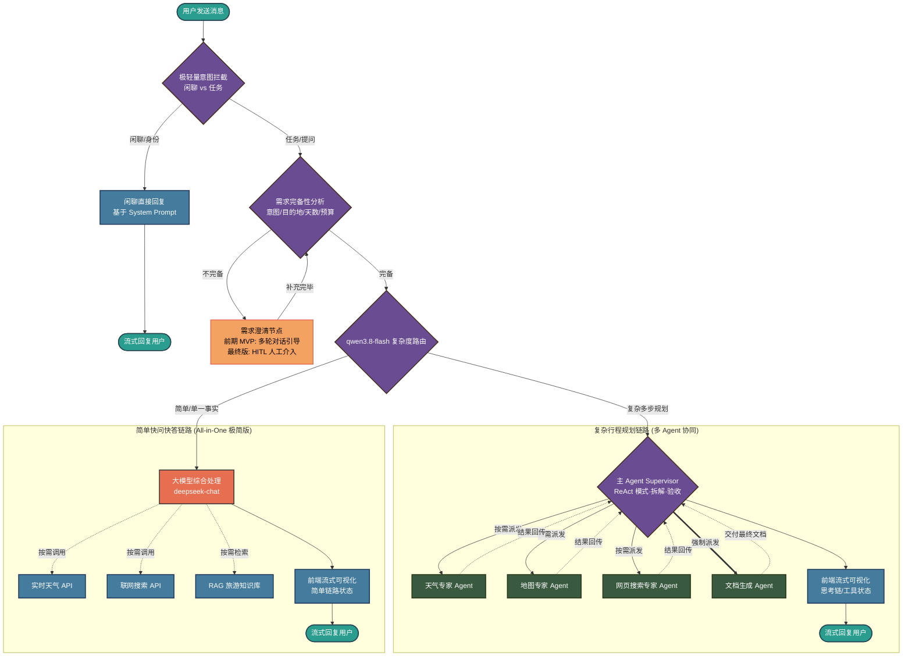

# AI 智能导游

基于 Spring AI 的 AI 旅游导览对话应用：提示词驱动的行程规划，叠加 RAG 检索增强（导游一手日本游语料），支持多轮流式对话与持久化记忆。

在线演示：[yuluo-ai.site](https://yuluo-ai.site)

## 功能

- SSE 流式多轮对话（`GET /api/chat/stream`），带 token 消耗统计
- 对话记忆持久化到 PostgreSQL（窗口 20 条，重启可恢复）
- RAG 检索增强（Agentic 形态）：检索管线封装为 `@Tool` `tripKnowledgeSearch`，由模型按需决定是否检索与检索什么，阈值 0.3 / topK 5；离线 ETL 由 `RegexTextSplitter` + `DocumentEtlUtils` 完成
- 会话管理：列表 / 历史懒加载 / 删除
- 前端 Vue3 单页聊天界面，Markdown + 代码高亮渲染，桌面 / 移动端响应式

规划中：需求复杂度路由、ReAct Agent、联网搜索工具、Supervisor 多 Agent 协同。

## 技术栈

- 后端：Java 21、Spring Boot 3.5、Spring AI 1.1（Spring AI Alibaba 提供 Embedding）
- 模型：DeepSeek（百炼 OpenAI 兼容模式接入）+ qwen text-embedding（1024 维）
- 数据：PostgreSQL 18 + pgvector（单库承载对话记忆、向量检索、业务表），MyBatis-Flex
- 前端：Vue 3 + TypeScript + Vite，原生 EventSource（SSE），markdown-it
- 部署：Docker Compose 一键编排（pgvector / backend / frontend 三服务）

## 架构图



> 图示为目标架构：闲聊直答 + RAG 快问快答链路已上线，多 Agent 复杂规划链路为后续阶段规划。

## 思考

**为什么单库 pgvector，而不是 MySQL + 独立向量库？**
项目体量下记忆表、向量表、业务表合一库即可，启动自动建表免运维；已从 MySQL 切到 PG，MySQL 驱动仅保留回退。

**为什么用 pgvector，而不是专业向量库 / ES？**
79 条语料的小规模检索，PG 内 HNSW + COSINE 完全够用，不为向量单引入一套基础设施，也避免与记忆库跨库一致性问题。

**为什么选 Spring AI 而不是 LangChain 等框架？**
与 Spring Boot 同栈，ChatClient/Advisor 声明式编排、pgvector 与 chat-memory starter 开箱即用，Prompt 用 `.st` 模板管理，全程不引入 Python 异构。

**为什么 RAG 先做 Naive 形态，而不是直接上 Agent 检索？**
语料小而精、问题固定（三问 gold set），先用 `QuestionAnswerAdvisor` 一行挂上把链路跑通，用实测调出阈值 0.3 / topK 5 和保真规则；参数定稿后再把检索封装为 `@Tool`，升级为模型按需调用的 Agentic 形态。这样调参与能力演进分两步，黑盒阶段测出的参数在工具化后原样复用。

## 快速开始

```bash
# 1. 安装 Docker Desktop（含 docker compose）

# 2. 克隆仓库
git clone https://github.com/EthanYuan06/ai-tour-guide.git
cd ai-tour-guide

# 3. 在项目根目录创建 .env，填入 DASHSCOPE_API_KEY、PG_PASSWORD 等变量

# 4. 一键启动
./deploy.sh up
```

启动后访问 [http://localhost:18080](http://localhost:18080)；

接口文档 `http://localhost:8123/api/doc.html`
