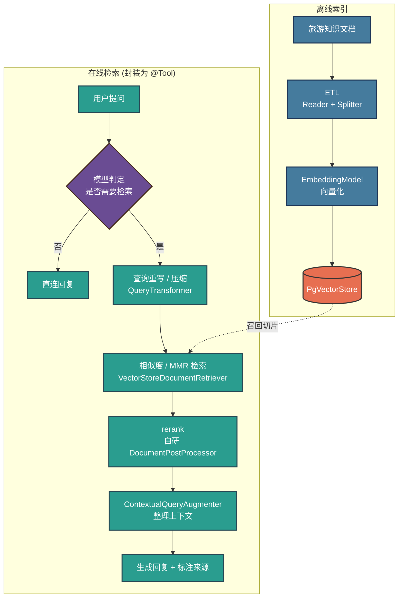

# AI 智能导游 - RAG 开发文档

> 配套《AI 智能导游 - 方案设计》阶段二的 RAG 细化执行文档，只描述知识库检索增强的选型、链路与迭代落地，不重复总体架构。总体方案见 [ai-guide-solution-design.md](./ai-guide-solution-design.md)。

## 一、对初步计划的纠偏说明

以下为对原始手写计划的修正，开发时以本文档为准：

1. **Agentic RAG 落地方式（核心纠正）**：`RetrievalAugmentationAdvisor` 的检索是**无条件前置**（每轮生成前必检索），属两步 / Naive RAG，直接挂它无法实现「大模型自行决定是否检索」的 Agentic RAG。最终形态改为：用其四模块**自编排检索管线**，再把整条管线**封装为 `@Tool`** 由模型按需调用。`RetrievalAugmentationAdvisor` 用于阶段三复现 Naive RAG 基线，`QuestionAnswerAdvisor` 仅用于阶段二黑盒可行性验证。
2. **组件名拼写**：`RetrivalAugmentationAdvisor` → `RetrievalAugmentationAdvisor`；`Pre-Retrival/Retrival/Post-Retrival` → `Pre-Retrieval/Retrieval/Post-Retrieval`。
3. **百炼知识库定位**：阶段一在阿里云百炼知识库做的 ETL 仅作**离线调参参考**（切分规则、相似度阈值、top-k），生产索引与 ETL 最终落在**本地 Spring AI 代码 + pgvector**，二者不混用。
4. **MMR / rerank 诚实标注**：Spring AI 无开箱 MMR 实现，rerank 也无内置模型对接，二者均以**自定义 `DocumentPostProcessor`** 落地（rerank 对接 DashScope rerank 模型），属自研而非框架默认能力。

## 二、选型结论

### 2.1 向量库：PostgreSQL + pgvector

单库同时承载文档正文与向量，支持精确 / 近似最近邻检索，Spring AI 提供 `PgVectorStore` 自动装配。项目 `pom.xml` 已含 `postgresql` 驱动，仅需补 store starter。业务数据仍在 MySQL，向量库独立于主库，职责清晰。

### 2.2 RAG 形态：Agentic RAG

由大模型在多轮对话中判断是否需要检索，涉及景点 / 路线 / 政策等知识性问题才触发向量检索，闲聊类不触发。与总体方案「RAG 按需触发、作为简单链路与 Agent 链路公共能力」的定位一致。相较两步 RAG（检索恒在生成前），Agentic 更省 token、更贴合对话式导游场景，代价是需自行把检索管线工具化。

### 2.3 组件对比

| 组件 | 编排能力 | 检索时机 | 定位 |
|---|---|---|---|
| `QuestionAnswerAdvisor` | 黑盒，仅调相似度阈值 / top-k | 无条件前置 | 阶段二可行性验证，不上简历 |
| `RetrievalAugmentationAdvisor` | 模块化四段，可自定义编排 | 无条件前置（Naive RAG） | 阶段三复现基线 + 编排增强 |
| 检索管线封装为 `@Tool` | 复用上述四模块自编排 | 模型按需调用（Agentic） | 最终形态 |

`RetrievalAugmentationAdvisor` 四模块：

- **Pre-Retrieval**：`QueryTransformer`（`RewriteQueryTransformer` 查询重写、`CompressQueryTransformer` 多轮压缩）、`QueryExpander`（`MultiQueryExpander` 多查询扩展）。
- **Retrieval**：`DocumentRetriever`（`VectorStoreDocumentRetriever`，配 `similarityThreshold` / `topK` / 过滤表达式）。
- **Post-Retrieval**：`DocumentPostProcessor`（自研 rerank、MMR 重排）。
- **Generation**：`QueryAugmenter`（`ContextualQueryAugmenter`，`allowEmptyContext` 控制空召回行为）。

## 三、目标链路

### 3.1 离线索引

文档采集 → ETL（`DocumentReader` 读取 + `TextSplitter` 切分）→ `EmbeddingModel` 向量化 → 写入 `PgVectorStore`。

### 3.2 在线检索（封装为 Tool，模型按需调用）

用户提问 →（模型判定是否需要检索）→ 查询重写 / 压缩 → 向量化 → 相似度 / MMR 检索 → 切片召回 → rerank → `ContextualQueryAugmenter` 整理上下文 → 生成回复并标注来源。

## 四、迭代阶段

### 阶段一：离线索引与调试

| 任务项 | 具体内容 | 交付物 | 验收标准 | 依赖 |
|---|---|---|---|---|
| 知识文档生成 | 用 AI 生成旅游相关知识文档（景点 / 路线 / 政策等） | 知识语料 | 覆盖典型导游问答场景 | 无 |
| 离线调参 | 在百炼知识库做 ETL 测试，调切分规则、相似度阈值、top-k（**仅作参考**） | 调参记录 | 得出一组可迁移到本地的参数 | 知识文档 |
| 环境准备 | 安装 PostgreSQL 并启用 pgvector 扩展 | 本地向量库 | 连接可用，扩展已加载 | 无 |
| 本地索引 | 用 Spring AI `DocumentReader`/`TextSplitter`/`EmbeddingModel` 跑通 ETL → 向量化 → 写入 `PgVectorStore` | 索引管线 | 文档入库，可按向量检索到切片 | 环境准备 |

### 阶段二：RAG 快速验证

| 任务项 | 具体内容 | 交付物 | 验收标准 | 依赖 |
|---|---|---|---|---|
| QuestionAnswerAdvisor 验证 | 挂 `QuestionAnswerAdvisor` 到 `ChatClient`，用阶段一参数验证本地检索效果 | 可运行的 Naive RAG | 知识类问题能召回并体现库内内容 | 阶段一 |

> 该阶段仅验证可行性，黑盒不可编排，不作为最终形态、不写简历。

### 阶段三：RAG 链路编排与 Agentic 化

| 任务项 | 具体内容 | 交付物 | 验收标准 | 依赖 |
|---|---|---|---|---|
| 复现 Naive RAG | 用 `RetrievalAugmentationAdvisor` 四模块复现基线链路 | 可编排 RAG 管线 | 端到端效果不低于阶段二 | 阶段二 |
| 检索增强 | 加 `RewriteQueryTransformer` / `MultiQueryExpander`；自研 `DocumentPostProcessor` 实现 rerank、MMR | 增强管线 | 多轮 / 模糊问题召回质量提升，来源可标注 | 基线管线 |
| Agentic 化 | 将整条检索管线封装为 `@Tool`，由模型按需调用 | Agentic RAG | 知识类问题触发检索，闲聊类不触发 | 增强管线 |
| 阶段验收 | 多轮对话端到端演练 | 验收记录 | 模型自主决定是否检索并正确展示私有知识 | 以上全部 |

## 五、最终效果

用户在多轮提问中，大模型根据需求自主决定是否触发 RAG 检索，将本项目私有旅游知识展示给用户；闲聊与非知识类问题不触发检索，来源可标注。

## 六、配置与依赖落地要点

**pom.xml 新增：**

- `spring-ai-starter-vector-store-pgvector`：`PgVectorStore` 自动装配。
- `spring-ai-rag`：`RetrievalAugmentationAdvisor` 及四模块。
- `spring-ai-advisors-vector-store`：`QuestionAnswerAdvisor`。

**application.yml / .env：**

- pgvector 数据源（独立于 MySQL 主库），`spring.ai.vectorstore.pgvector.initialize-schema: true` 幂等建表。
- Embedding 走 DashScope OpenAI 兼容 `text-embedding-v4`，增配 `spring.ai.openai.embedding.*`（base-url / api-key / model），密钥经 `.env` 注入不入库。
- 检索参数（`similarityThreshold` / `topK`）单源配置，沿用阶段一调参结果。

**代码落点：**

- `ChatAiConfig` 后续挂 advisor / 注册检索 `@Tool`；检索管线封装在独立 service，保持分层与单一职责。

> 本文档只描述方案，pom 与 yml 的实际改动在对应开发阶段执行。

## 七、遵循阿里 Java 手册

- **命名与常量**：类 / 方法 / 变量遵循驼峰与语义化命名，检索参数阈值等以常量或配置项集中管理，禁止魔法值散落。
- **集合与并发**：召回结果处理优先 `Stream` / 不可变集合；工具调用与检索管线若并发执行，共享状态需线程安全，避免可变全局态。
- **异常与日志**：向量库 / embedding 调用失败需捕获并降级（无检索时保留基础回答能力），异常不吞不裸抛；日志分级，检索命中、token 消耗按 `info`/`debug` 区分，避免全文进 `info` 日志。
- **MySQL / ORM 规约**：pgvector 与 MySQL 数据源隔离，建表脚本幂等（`IF NOT EXISTS`），字段与索引命名规范统一。

## 八、企业常见开发规范

- **分层与单一职责**：检索管线、Tool 封装、配置装配分层，不在 Controller / 装配类里写检索业务逻辑。
- **配置单源**：阈值、top-k、模型名等参数集中在配置，禁止多处硬编码同一值。
- **幂等与可重入**：索引建表、文档入库支持重复执行不产生脏数据。
- **来源可追溯**：回复标注召回文档来源，便于验证与排错。
- **可观测**：复用现有 token 统计与日志 advisor，记录是否触发检索、召回条数与耗时。
- **密钥治理**：DashScope / 数据库密钥经 `.env` 注入，不写入代码与版本库。
