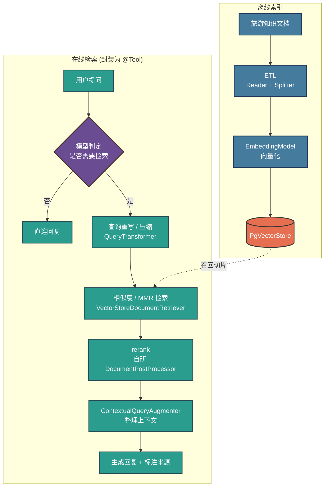

# AI 智能导游 - RAG 开发文档

> 配套《AI 智能导游 - 方案设计》阶段二的 RAG 细化执行文档，只描述知识库检索增强的选型、链路与迭代落地，不重复总体架构。总体方案见 [ai-guide-solution-design.md](./ai-guide-solution-design.md)。

## 一、对初步计划的纠偏说明

以下为对原始手写计划的修正，开发时以本文档为准：

1. **Agentic RAG 落地方式（核心纠正）**：`RetrievalAugmentationAdvisor` 的检索是**无条件前置**（每轮生成前必检索），属两步 / Naive RAG，直接挂它无法实现「大模型自行决定是否检索」的 Agentic RAG。最终形态改为：用其四模块**自编排检索管线**，再把整条管线**封装为 `@Tool`** 由模型按需调用。`RetrievalAugmentationAdvisor` 用于阶段三复现 Naive RAG 基线，`QuestionAnswerAdvisor` 仅用于阶段二黑盒可行性验证。
2. **组件名拼写**：`RetrivalAugmentationAdvisor` → `RetrievalAugmentationAdvisor`；`Pre-Retrival/Retrival/Post-Retrival` → `Pre-Retrieval/Retrieval/Post-Retrieval`。
3. **百炼知识库定位**：阶段一在阿里云百炼知识库做的 ETL 仅作**离线调参参考**（切分规则、相似度阈值、top-k），生产索引与 ETL 最终落在**本地 Spring AI 代码 + pgvector**，二者不混用。
4. **MMR / rerank 诚实标注**：Spring AI 无开箱 MMR 实现，rerank 也无内置模型对接，二者均以**自定义 `DocumentPostProcessor`** 落地（rerank 对接 DashScope rerank 模型），属自研而非框架默认能力。

## 二、选型结论

### 2.1 向量库：PostgreSQL + pgvector

单库同时承载文档正文与向量，支持精确 / 近似最近邻检索，Spring AI 提供 `PgVectorStore` 自动装配。项目 `pom.xml` 已含 `postgresql` 驱动，仅需补 store starter。

> 落地调整（2026-11-16）：pgvector 的自动装配只绑定 `spring.datasource` 这一个数据源，为免双库装配偏离框架默认，应用数据源已**整体切到云 PostgreSQL**（本地 MySQL 弃用，驱动保留作回退），对话记忆表与向量表同库同源；MySQL 历史会话数据不迁移。

### 2.2 RAG 形态：Agentic RAG

由大模型在多轮对话中判断是否需要检索，涉及景点 / 路线 / 政策等知识性问题才触发向量检索，闲聊类不触发。与总体方案「RAG 按需触发、作为简单链路与 Agent 链路公共能力」的定位一致。相较两步 RAG（检索恒在生成前），Agentic 更省 token、更贴合对话式导游场景，代价是需自行把检索管线工具化。

### 2.3 组件对比

| 组件 | 编排能力 | 检索时机 | 定位 |
|---|---|---|---|
| `QuestionAnswerAdvisor` | 黑盒，仅调相似度阈值 / top-k | 无条件前置 | 阶段二可行性验证，不上简历 |
| `RetrievalAugmentationAdvisor` | 模块化四段，可自定义编排 | 无条件前置（Naive RAG） | 阶段三复现基线 + 编排增强 |
| 检索管线封装为 `@Tool` | 复用上述四模块自编排 | 模型按需调用（Agentic） | 最终形态 |

`RetrievalAugmentationAdvisor` 四模块：

- **Pre-Retrieval**：`QueryTransformer`（`RewriteQueryTransformer` 查询重写、`CompressQueryTransformer` 多轮压缩）、`QueryExpander`（`MultiQueryExpander` 多查询扩展）。
- **Retrieval**：`DocumentRetriever`（`VectorStoreDocumentRetriever`，配 `similarityThreshold` / `topK` / 过滤表达式）。
- **Post-Retrieval**：`DocumentPostProcessor`（自研 rerank、MMR 重排）。
- **Generation**：`QueryAugmenter`（`ContextualQueryAugmenter`，`allowEmptyContext` 控制空召回行为）。

## 三、目标链路

### 3.1 离线索引

文档采集 → ETL（`DocumentReader` 读取 + `TextSplitter` 切分）→ `EmbeddingModel` 向量化 → 写入 `PgVectorStore`。

### 3.2 在线检索（封装为 Tool，模型按需调用）

用户提问 →（模型判定是否需要检索）→ 查询重写 / 压缩 → 向量化 → 相似度 / MMR 检索 → 切片召回 → rerank → `ContextualQueryAugmenter` 整理上下文 → 生成回复并标注来源。



## 四、迭代阶段

> 完成度标记（更新于 2026-11-16）：✅ 已完成并实测通过 ｜ ⏳ 部分完成 ｜ ⬜ 未开始。

### 阶段一：离线索引与调试

| 状态 | 任务项 | 具体内容 | 交付物 | 验收标准 | 依赖 |
|---|---|---|---|---|---|
| ✅ | 知识文档生成 | 用 AI 生成旅游相关知识文档（景点 / 路线 / 政策等） | 知识语料 | 覆盖典型导游问答场景 | 无 |
| ⏳ | 离线调参 | 在百炼知识库做 ETL 测试，调切分规则、相似度阈值、top-k（**仅作参考**） | 调参记录 | 得出一组可迁移到本地的参数 | 知识文档 |
| ✅ | 环境准备 | 准备 PostgreSQL 实例并启用 pgvector 扩展 | 向量库环境 | 连接可用，扩展已加载 | 无 |
| ⬜ | 本地索引 | 用 Spring AI `DocumentReader`/`TextSplitter`/`EmbeddingModel` 跑通 ETL → 向量化 → 写入 `PgVectorStore` | 索引管线 | 文档入库，可按向量检索到切片 | 环境准备 |

阶段一已完成部分的实际落地情况：

- **知识文档**：`docs/rag/` 共 8 篇、78 个条目（交通 17 / 体验关西 12 / 体验关东 11 / 餐饮购物娱乐 10 / 住宿与城际 9 / 注意事项 8 / 证件与换汇 6 / 签证 5），条目自带 `【类别｜…】` 元数据头。
- **环境准备（与原计划的差异）**：不用本地安装，改用**阿里云百炼开通的云 PostgreSQL 18.6**；`vector`、`hstore`、`uuid-ossp` 三个扩展均已就绪，公网地址连通。应用 `spring.datasource` 整体切到该库（弃用本地 MySQL），使 Spring AI 的 `JdbcChatMemoryRepository` 与 `PgVectorStore` 共用同一个数据源，从根上消掉多数据源装配。启动实测已自动建出两张表：`spring_ai_chat_memory`、`vector_store(embedding vector(1024))` + HNSW 索引 `spring_ai_vector_index`；对话链路在新库上回归通过。
- **离线调参**：切分规则已定（按 `(?=【)` 条目边界切、块长 800、重叠 0），但**相似度阈值与 top-k 尚未测**——需要本地入库完成后才能跑召回，属阶段一收尾项。
- **本地索引**：ETL 管线未实施，留下一轮。

### 阶段二：RAG 快速验证

| 状态 | 任务项 | 具体内容 | 交付物 | 验收标准 | 依赖 |
|---|---|---|---|---|---|
| ⬜ | QuestionAnswerAdvisor 验证 | 挂 `QuestionAnswerAdvisor` 到 `ChatClient`，用阶段一参数验证本地检索效果 | 可运行的 Naive RAG | 知识类问题能召回并体现库内内容 | 阶段一 |

> 该阶段仅验证可行性，黑盒不可编排，不作为最终形态、不写简历。

### 阶段三：RAG 链路编排与 Agentic 化

| 状态 | 任务项 | 具体内容 | 交付物 | 验收标准 | 依赖 |
|---|---|---|---|---|---|
| ⬜ | 复现 Naive RAG | 用 `RetrievalAugmentationAdvisor` 四模块复现基线链路 | 可编排 RAG 管线 | 端到端效果不低于阶段二 | 阶段二 |
| ⬜ | 检索增强 | 加 `RewriteQueryTransformer` / `MultiQueryExpander`；自研 `DocumentPostProcessor` 实现 rerank、MMR | 增强管线 | 多轮 / 模糊问题召回质量提升，来源可标注 | 基线管线 |
| ⬜ | Agentic 化 | 将整条检索管线封装为 `@Tool`，由模型按需调用 | Agentic RAG | 知识类问题触发检索，闲聊类不触发 | 增强管线 |
| ⬜ | 阶段验收 | 多轮对话端到端演练 | 验收记录 | 模型自主决定是否检索并正确展示私有知识 | 以上全部 |

## 五、最终效果

用户在多轮提问中，大模型根据需求自主决定是否触发 RAG 检索，将本项目私有旅游知识展示给用户；闲聊与非知识类问题不触发检索，来源可标注。

## 六、配置与依赖落地要点

**pom.xml 新增：**

- ✅ `spring-ai-starter-vector-store-pgvector`：`PgVectorStore` 自动装配（1.1.2 已落地，依赖树含 `spring-ai-pgvector-store` 与 `com.pgvector:pgvector:0.1.6`）。
- ⬜ `spring-ai-rag`：`RetrievalAugmentationAdvisor` 及四模块。
- ⬜ `spring-ai-advisors-vector-store`：`QuestionAnswerAdvisor`。

**application.yml / .env：**

- ✅ 数据源单库 PostgreSQL：`spring.datasource` 的 url / username / password 写作 `${PG_URL}` / `${PG_USERNAME}` / `${PG_PASSWORD}`，真实值放 `.env`（已 gitignore，不入库）；对话记忆表与向量表同库同源，不再有「pgvector 独立于主库」的双数据源问题。
- ✅ `spring.ai.vectorstore.pgvector.initialize-schema: true` 幂等建表（建表脚本依赖的 `vector` / `hstore` / `uuid-ossp` 已在实例装好），`index-type: HNSW`、`distance-type: COSINE_DISTANCE`、`dimensions: 1024`。
- ✅ Embedding 走 DashScope OpenAI 兼容模式：`spring.ai.model.embedding: openai` + `spring.ai.openai.embedding.options.{model, dimensions}`。**模型定为 `qwen3.7-text-embedding-flash`、维度 1024**（原文档写的 `text-embedding-v4` / 1536 已作废：flash 只支持 1024/768/512/256）；`dimensions` 与 `vectorstore.pgvector.dimensions` 必须一致，否则入库报 `22000 vector type mismatch`。
- ⬜ 检索参数（`similarityThreshold` / `topK`）单源配置，沿用阶段一调参结果。

**代码落点：**

- ⬜ `ChatAiConfig` 后续挂 advisor / 注册检索 `@Tool`；检索管线封装在独立 service，保持分层与单一职责。
- ✅ 切 PG 已改的方言点：`ConversationService` 会话列表的 epoch 取值改为 `CAST(FLOOR(EXTRACT(EPOCH FROM MIN("timestamp" AT TIME ZONE 'Asia/Shanghai'))) AS BIGINT)`；`ChatMemoryEntity` 的 `@Table` 改小写 `spring_ai_chat_memory`。

> 本文档描述方案，pom 与 yml 的实际改动在对应开发阶段执行；上面带 ✅ 的条目表示已落地并实测通过。

## 七、遵循阿里 Java 手册

- **命名与常量**：类 / 方法 / 变量遵循驼峰与语义化命名，检索参数阈值等以常量或配置项集中管理，禁止魔法值散落。
- **集合与并发**：召回结果处理优先 `Stream` / 不可变集合；工具调用与检索管线若并发执行，共享状态需线程安全，避免可变全局态。
- **异常与日志**：向量库 / embedding 调用失败需捕获并降级（无检索时保留基础回答能力），异常不吞不裸抛；日志分级，检索命中、token 消耗按 `info`/`debug` 区分，避免全文进 `info` 日志。
- **数据库 / ORM 规约**：对话记忆与向量表统一落在 PostgreSQL 单库，建表脚本幂等（`IF NOT EXISTS`），字段与索引命名规范统一。切库带来两条 PG 侧硬约束：MyBatis-Flex 在 PG 方言下给标识符加双引号，实体表名必须小写；`timestamp without time zone` 列取 epoch 前要先 `AT TIME ZONE` 声明时区，否则时间戳会偏 8 小时。

## 八、企业常见开发规范

- **分层与单一职责**：检索管线、Tool 封装、配置装配分层，不在 Controller / 装配类里写检索业务逻辑。
- **配置单源**：阈值、top-k、模型名等参数集中在配置，禁止多处硬编码同一值。
- **幂等与可重入**：索引建表、文档入库支持重复执行不产生脏数据。
- **来源可追溯**：回复标注召回文档来源，便于验证与排错。
- **可观测**：复用现有 token 统计与日志 advisor，记录是否触发检索、召回条数与耗时。
- **密钥治理**：DashScope / 数据库密钥经 `.env` 注入，不写入代码与版本库。

## 九、知识文档格式规范与示例（五类）

> 阶段一知识库范围收敛为**消费明细 + 旅游体验**两类私域内容作调参沙盒，另备景区介绍、注意事项、签证要求三类，其中签证要求兼作长说明文的异构调参对照。验收固定三问（去日本旅游消费如何 / 交通费贵不贵 / 有什么需要注意的），并为每问预写 gold set（各 3–5 条预期召回条目）。

### 9.1 五类共用格式约定

1. 每个条目自带一行元数据头（检索调参与过滤表达式依赖它）。
2. 一个条目只讲一件事，2–5 行以内，自包含到「单独捞出这一条也能看懂」。
3. 所有事实带时间锚（2025.7）与货币单位（円）；体验类额外区分「客观 / 主观」。

**保真规则**：消费明细、注意事项、旅游体验的内容源头全部为用户一手经历，只做转述与结构化，**不添加用户未经历的任何细节**；景区介绍的事实部分由公开资料补全并交用户核对；签证要求全部以官方源核实为准。

### 9.2 景区介绍 —— 说明书式短条目，只放可查证事实

```text
【景区介绍｜京都｜清水寺｜记录:2025.7】
清水寺位于京都市东山区，本堂舞台为悬空木造结构，正对音羽山山谷。门票 500 円，全年开放，日间 6:00–18:00。
到达方式：京阪本线清水五条站下，步行约 20 分钟上坡；或市巴士 86/206 路「清水道」站下步行 10 分钟。建议游玩时长 1.5–2 小时。
三年坂、二年坂连接清水寺与八坂神社，沿途为坡道商店街，单程步行约 15 分钟。
```

要点：名称、位置、票价、时间、到达、时长——回答行程编排问题的最小事实集。不含「很美」「值得去」这类评价（那是体验类的职责）。

### 9.3 消费明细 —— 三层结构：分段价、券回本、城市汇总

```text
【消费明细｜镰仓·江之岛｜交通｜记录:2025.7｜单人】
江之电一日券 800 円，当日江之电全线不限次乘坐。实测当日乘坐 5 段散客票合计约 1050 円，购买省 250 円。结论：单日内计划乘 4 段以上江之电即回本。
```

```text
【消费明细｜东京｜交通｜记录:2025.7｜单人】
东京 Metro+都营地下铁 1500 円券（72 小时），实测使用期间抵消票价共 3082 円，净省 1582 円。适用前提：行程以地下铁为主；若大量乘坐 JR 山手线（新宿—涩谷—池袋间），该券不覆盖 JR，需谨慎。
```

```text
【消费明细｜全行程汇总｜记录:2025.7｜单人｜1円≈0.0488元(2025.7汇率)】
大阪—京都—东京（含奈良、镰仓当日往返）全程市内+城际交通合计 25271 円，约 1233 元。日均交通支出约 1400 円；其中东京市内日均 900–1300 円，京都常规日 900–1000 円、含贵船往返日为 5750 円（远距离 outlier，勿当常规日参考）。
```

要点：价目条给「结论 + 依据」；汇总条专门回答「消费如何」这类总量问题——top-k 调参时需验证汇总条目能否稳定带出、又不淹没明细碎片。

### 9.4 行为举止注意事项 —— 规则式：场景 + 该怎么做 + 违反的后果

```text
【注意事项｜公共交通｜记录:2025.7】
电车内禁止通话，手机应调静音；新干线与通勤电车车厢内基本无人交谈出声。大声通话不会有人制止或罚款，属社会礼仪范畴，但会引来侧目。带小孩出行建议错峰或选择车厢端部。
```

```text
【注意事项｜温泉/钱汤｜记录:2025.7】
入池前必须先淋浴冲洗；小毛巾不得带入浴池，放在池边或搭在头顶。入池后不得再泡池往返餐饮区。有纹身者部分钱汤拒绝入内，需提前查官网规定或选可遮挡的时段。
```

要点：写「规则 + 现实后果」两层。模型泛答常只有规则没有后果（会不会被罚款、有没有人管），后者才是用户真正想知道的。

### 9.5 签证要求 —— 长说明文，每篇必须带来源与核实日期

唯一允许成篇的类别，兼作异构切分调参对照样本：

```text
【签证｜中国大陆护照·短期观光单次｜来源:日本驻华大使馆官网｜核实日期:待入库前核实】
一、适用情形：以观光为目的、停留 15 日以内……
二、申请材料：护照原件（有效期 6 个月以上）、签证申请表、照片（4.5×4.5cm）、
    经济能力证明（在职证明+银行流水，或按领区规定的免税材料组合）……
三、费用与时效：单次签证手续费约 xxx 円等值人民币，加急另计；审理约 5 个工作日起……
四、注意事项：领区按户籍/居住证划分；代办旅行社另收服务费……
```

要点：示例仅为形态说明，数字留占位、以官方源核实后填入；「核实日期」字段用于政策变更后按日期批量替换。

### 9.6 旅游体验 —— 第一人称，客观事实与主观感受物理分开

```text
【旅游体验｜京都·贵船神社｜2025.7 下午｜自由行·单人】
客观：从京都站乘叡电至贵船站约 1 小时，末段山路单轨会车；神社本体到最上游的水占神社单程步行约 30 分钟，石阶多、坡度大。当日 15:00 到达，参道几乎无人排队。
主观（仅供参考）：山间比市区低明显一截，夏日体感舒适；石阶对体力有要求，穿凉鞋会后悔。
```

要点：同一段经历拆「客观」「主观（仅供参考）」两小段写在同一元数据块内；仅转述用户经历，不代写未体验的细节。

### 9.7 待定格式参数

以下三项可由用户调整后定稿：元数据头字段（现为「｜记录:2025.7｜单人」样式）、条目长度（现约 100–200 字/条，过长影响按段落切分时的召回纯度）、体验类「客观/主观」二分是否保留。

> 交通数据五个疑点（奈良 580 円实际线路、「+205」类第二数字含义、单人/分摊口径、丰乡·淡水町地名、汇率口径）澄清前，相关条目不入库。
