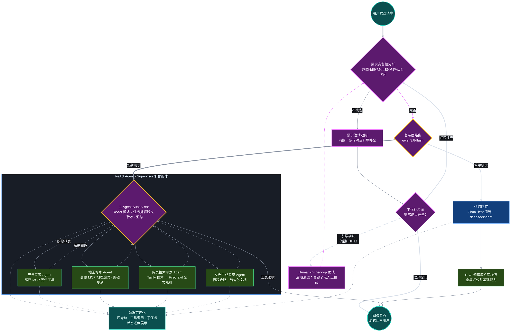

# AI 智能导游 - 方案设计

> 配套《AI 智能导游 - 需求分析》的技术方案文档。本文描述最终技术目标、技术选型对比、开发主线、分阶段 Task 与风险对策。项目定位为求职作品集，所有技术按实现复杂度分阶段引入，MVP 边界与需求分析保持一致。

## 一、目标架构与技术目标

### 1.1 最终要达到的技术目标

1. **需求复杂度路由**：由 qwen3.8-flash 对每条用户消息做复杂度分析，简单需求走 ChatClient 直连对话，复杂需求（需实时信息、多步规划、多工具协作）转入 Agent 模式，避免所有请求都走重链路。
2. **ReAct Agent 工具调用**：基于 deepseek-chat 的 Agent 按“思考—行动—观察”循环工作；联网检索采用两级策略，先 Tavily 搜索拿到候选链接与摘要，信息不足时再用 Firecrawl 抓取目标页面全文。
3. **MCP 工具与多智能体**：接入高德地图 MCP（已含天气查询能力），并在 Agent 路线上设计 Supervisor 多智能体架构，由 Supervisor 调度地图、天气、检索等子 Agent 并发工作。
4. **全模式 RAG**：无论简单对话还是 Agent 模式，生成前都经过旅游知识库检索增强，RAG 作为两种模式的公共基础能力。

### 1.2 架构分层（文字描述）

- **接入层**：Vue3 + Vite 构建的响应式 Web 界面，负责对话交互、流式渲染与行程展示。
- **应用层**：Spring Boot 承载 ChatClient、复杂度路由、RAG 检索、ReAct Agent、Supervisor 编排与记忆管理。
- **能力与数据层**：DashScope 大模型、Tavily/Firecrawl 联网 API、高德 MCP 服务，以及 MySQL、PostgreSQL（pgvector）、Redis 三类存储。
- **调用关系**：前端请求应用层；路由节点决定直连或 Agent；两条链路统一经过 RAG 检索；Agent 通过 MCP Client 与联网工具完成任务；MVP 采用内存会话，阶段二起改用 SAA 内置的 RedisChatMemory 承载对话记忆。

### 1.3 目标架构流程图

要点说明：

1. **模型分工与分流**：需求完备性判断与复杂度路由由 qwen3.8-flash 承担；简单需求走 ChatClient（deepseek-chat）直连并经 RAG 增强后回答，复杂需求进入 Supervisor 多智能体链路，与 1.1、2.6 的设计一一对应。
2. **HITL 演进路径**：需求澄清前期依赖多轮对话引导（阶段一系统提示词能力），阶段五接入 Human-in-the-loop 后，关键节点可人工拦截确认再恢复执行，图中以紫色虚线分支表示该演进能力。
3. **前端可见性**：Supervisor 的工具调用与子 Agent 派发过程事件均以虚线推送至前端，逐段展示思考链、工具调用与子任务状态，配合流式输出保证长链路可感知。

## 二、技术选型（横向对比）

### 2.1 AI 应用框架（重点：Java / Python）

| 对比维度 | Spring AI Alibaba（Java） | LangChain4j（Java） | LangChain / LangGraph（Python） |
|---|---|---|---|
| 语言与运行时 | JVM，Spring 生态原生 | JVM，框架无关（Spring/Quarkus/纯 Java 均可） | Python，独立运行时 |
| 对话抽象 | ChatClient + Advisor 链，自动装配 | AiServices 注解接口，抽象成熟 | Chain / Runnable 组合 |
| RAG 能力 | 文档加载、切分、VectorStore 完整 | 文档摄取与检索生态丰富，成熟度高 | 组件最全，生态最大 |
| Agent / ReAct | Agent Framework 内置 ReactAgent、Hooks、Skills | 支持 ReAct，Chain/Agent 抽象成熟 | LangGraph 支持状态图、复杂 Agent 编排 |
| 多智能体 | 原生 Supervisor、Routing 多智能体 | 需自行组合实现 | LangGraph 多 Agent 能力强 |
| MCP 支持 | 原生 MCP Client，自动注入 ToolCallback | 支持 MCP | 支持 MCP |
| 国产模型适配 | 原生 DashScope/通义，适配最佳 | 需额外集成 | 需额外集成 |
| 学习与维护成本 | 与 Java 技术栈一致，无异构负担 | 与 Java 技术栈一致 | 需引入 Python 服务，双语言维护 |
| 求职匹配度 | 高，直接对应 Java AI 应用开发岗 | 高 | 中，偏算法/Python 岗位 |

**选型结论：采用 Spring AI Alibaba 1.1.2.0（基于 Spring AI 1.1.2）。**

- 项目以 Java 单语言栈交付，避免同时维护 Python 服务带来的部署与联调成本。
- ReactAgent、Supervisor、Routing、MCP、DashScope 适配均为框架内置，与目标架构一一对应，样板代码少。
- 与求职方向（Java / AI 应用开发）高度匹配；LangChain4j 与 LangGraph 作为对比认知和面试谈资掌握，不进入生产技术栈。

### 2.2 前端框架与构建工具

| 项 | 方案 | 说明 |
|---|---|---|
| 框架 | Vue3 | 组合式 API，组件化开发对话界面，响应式生态成熟 |
| 构建 | Vite | 开发期冷启动快、热更新即时；配置简单，适合中小项目 |
| Vite vs Webpack | 选 Vite | Webpack 生态全但配置重、构建慢；本项目无复杂定制打包需求，Vite 性价比更高 |

### 2.3 数据存储

| 存储 | 职责 | 引入阶段 | 选型理由 |
|---|---|---|---|
| MySQL | 业务数据持久化 | 阶段二 | 关系型主库，承载用户、行程等业务数据 |
| PostgreSQL + pgvector | RAG 知识库向量存储与相似检索 | 阶段二 | 单库同时承载文档与向量，支持精确/近似最近邻，Spring AI 提供 PGvector VectorStore |
| Redis | 基于 SAA RedisChatMemory 的对话记忆 | 阶段二 | 读写延迟低，直接使用框架内置的 RedisChatMemory，无需手写序列化与缓存逻辑 |

说明：MVP 阶段不引入任何数据库，记忆仍保存在内存；存储三件套从阶段二开始落地，RAG 初期可先用轻量内存向量存储跑通，再迁移到 pgvector。

### 2.4 记忆实现方式：直接使用框架组件

不自行实现记忆序列化，直接使用 SAA 内置的记忆组件：MVP 用内存实现，阶段二起用 RedisChatMemory。原因是通用 JSON 序列化与 Spring AI 的 Message 接口不兼容，手写消息转换与序列化逻辑成本高且易出错；框架组件已封装存储格式与读写流程，开箱即用。

### 2.5 联网检索与 MCP 接入

| 工具 | 定位 | 输出形态 | 在本项目的角色 |
|---|---|---|---|
| Tavily | 搜索优先（search-first） | AI 排序结果、摘要、引用与候选 URL | 联网第一跳，快速定位信息源 |
| Firecrawl | 提取优先（extraction-first） | LLM 友好的 Markdown / 结构化 JSON | 第二跳，需要页面全文细节时抓取 |

- **两级策略**：默认只调 Tavily；当摘要不足以支撑回答（如需要完整攻略、政策细则、票务条款）时，Agent 再对指定 URL 调 Firecrawl，兼顾成本与信息深度。
- **MCP 接入**：高德 MCP Server 支持 Streamable HTTP（推荐）与 Node.js I/O 两种方式；应用层通过 Spring AI MCP Client 连接，工具以 ToolCallbackProvider 自动注入，无需手写调用封装。
- **天气能力**：高德 MCP 已内置按城市名 / adcode 查询天气的工具，因此不再独立引入天气 MCP；如后续需要专业气象数据，再评估独立天气服务。

### 2.6 模型分工

| 环节 | 模型 | 选择理由 |
|---|---|---|
| 复杂度路由 | qwen3.8-flash | Flash 档快速且低成本，分类任务对推理要求低，降低路由开销 |
| 简单对话 | deepseek-chat | 通用对话与行程生成能力强，直连链路输出稳定 |
| ReAct Agent | deepseek-chat | 工具调用与多步推理表现好，同一模型贯通 Agent 链路 |

说明：deepseek-chat 为 DeepSeek 官方对话模型名，百炼平台侧可对应 deepseek-v4 系列；通过多模型配置分别注入路由节点与对话、Agent 链路。

## 三、项目开发流程（主线）

1. **环境与账号准备**：安装 JDK 17+、Node.js 与 Git；申请 DashScope、Tavily、Firecrawl、高德开放平台 Key 并验证可用性。
2. **工程骨架**：后端用 Spring Initializr 搭建 Boot 3.5.x 工程并引入 SAA BOM；前端用 Vite 创建 Vue3 工程；约定前后端接口规范与目录结构。
3. **阶段一 MVP 开发**：完成 ChatClient 接入、系统提示词、内存会话、流式输出与对话界面，按验收门禁通过后再进入下一阶段。
4. **阶段二 RAG 与持久化**：搭建知识库与向量检索，接入 RedisChatMemory 与 MySQL 业务存储，验证 RAG 在直连链路生效。
5. **阶段三 Agent 与联网**：实现复杂度路由与 ReAct Agent，接入 Tavily/Firecrawl，补齐工具调用日志与失败处理。
6. **阶段四 MCP 与多智能体**：接入高德 MCP，将单 Agent 演进为 Supervisor 架构并验证子 Agent 并发，接入可观测能力。
7. **阶段验收门禁**：每阶段完成后对照 Task 表验收，未通过不进入下一阶段；问题记录到风险清单并优先修复。
8. **收尾沉淀**：整理 README、部署脚本与演示数据，提炼简历项目描述与面试问答。

关键决策点：框架版本以 SAA 兼容表为准（当前 Boot 3.5.x）；Spring Boot 4 待 SAA 官方适配后再迁移，不在开发中途强行升级。

## 四、分阶段 Task 任务表

### 阶段一：MVP（提示词驱动对话）

| 任务项 | 具体内容 | 交付物 | 验收标准 | 依赖 |
|---|---|---|---|---|
| 前端界面 | 居中输入框、消息流、基础响应式 | 可运行的 Vue 页面 | 页面加载即可输入，多轮历史完整展示 | 工程骨架 |
| 模型接入 | 接入 ChatClient，配置 DashScope | 后端对话接口 | 接口可正常返回模型回复 | 账号准备 |
| 系统提示词 | 智能导游角色、需求澄清与结构化输出规则 | 提示词配置 | 信息不足时主动追问，输出含日程/景点/预算 | 模型接入 |
| 内存会话 | 基于内存的多轮上下文 | 会话管理模块 | 支持连续追问，重启后清空（预期行为） | 模型接入 |
| 流式输出 | 接入 ChatClient 流式接口，前端逐段渲染 | 流式对话能力 | 回复逐段呈现，无明显整段等待，渲染不卡顿 | 模型接入 |
| 阶段验收 | 端到端走查典型旅游需求 | 验收记录 | 能输出完整定制化行程 | 以上全部 |

### 阶段二：RAG + 持久化

| 任务项 | 具体内容 | 交付物 | 验收标准 | 依赖 |
|---|---|---|---|---|
| 知识库建设 | 旅游文档收集、清洗、切分与向量化 | 知识文档与索引 | 文档可被检索，切分无明显断句问题 | MVP 验收 |
| 向量检索 | 先内存向量存储跑通，再迁移 pgvector | VectorStore 配置 | 相似问题能召回相关片段并注入上下文 | 知识库 |
| RedisChatMemory 接入 | 用 SAA RedisChatMemory 替换内存实现，记忆写入 Redis | RedisChatMemory 配置 | 会话记忆可写入并读取，重启服务后历史可恢复 | 数据库环境 |
| 全链路 RAG | 直连对话默认经过 RAG 增强 | 增强后的对话链路 | 回答可体现知识库内容，来源可标注 | 向量检索 |

### 阶段三：ReAct Agent + 联网

| 任务项 | 具体内容 | 交付物 | 验收标准 | 依赖 |
|---|---|---|---|---|
| 复杂度路由 | 用 qwen3.8-flash 分析消息复杂度，分流直连与 Agent | 路由模块 | 典型简单/复杂用例分流正确 | 阶段二 |
| ReAct Agent | 基于 Agent Framework 与 deepseek-chat 构建 ReactAgent | Agent 服务 | 能按思考—行动循环完成任务 | 路由模块 |
| Tavily 接入 | 联网第一跳搜索与摘要 | Tavily 工具 | 可返回候选 URL 与摘要 | Agent 服务 |
| Firecrawl 接入 | 按需抓取页面全文 | Firecrawl 工具 | 摘要不足时可拿到全文 Markdown | Tavily |
| 容错与日志 | 超时、重试、调用链日志 | 日志与异常处理 | 工具失败可重试或降级，不中断对话 | 全部工具 |

### 阶段四：MCP + Supervisor 多智能体

| 任务项 | 具体内容 | 交付物 | 验收标准 | 依赖 |
|---|---|---|---|---|
| 高德 MCP | Streamable HTTP 接入 MCP Client | 地图/天气工具集 | 地理编码、路线规划、天气查询可调通 | 阶段三 |
| Supervisor 架构 | 拆分地图、天气、检索子 Agent，Supervisor 调度 | 多智能体编排 | 子 Agent 可并发执行，结果正确汇总 | 高德 MCP |
| 上下文隔离 | 子 Agent 独立上下文，避免互相污染 | 上下文管理 | 各子任务输出互不串扰 | Supervisor |
| 可观测性 | 接入 graph-observation，Micrometer/OTel | 监控与链路追踪 | 调用链可在监控中查看 | 多智能体 |
| 阶段验收 | 复杂旅游需求端到端演练 | 验收记录 | 多工具并发协作输出完整方案 | 以上全部 |

### 阶段五：亮点增强（可选，不影响主线）

| 任务项 | 具体内容 | 验收标准 |
|---|---|---|
| Human-in-the-loop | 关键节点人工确认后再执行 | 确认节点可拦截、修改并恢复执行 |
| 配置热更新 | Nacos 管理提示词与模型配置 | 修改配置无需重启即生效 |
| 集成测试 | Testcontainers 拉起数据库与依赖做测试 | 核心链路自动化测试可通过 |

## 五、关键风险与对策

| 风险 | 影响 | 对策 |
|---|---|---|
| Spring Boot 4 无 SAA 适配 | 强行升级导致自动装配/依赖冲突 | 主线锁定 Boot 3.5.x，跟踪官方兼容表，适配后再迁移 |
| Agent 工具失败或循环 | 任务卡死、回复异常 | 设置超时、最大迭代次数与重试，失败降级为直连回答 |
| 外部 API 成本与配额 | 调用费用超预期、限流 | 默认只调 Tavily，Firecrawl 按需触发；控制上下文长度与频次 |
| 记忆存储可用性 | Redis 宕机或内存淘汰导致记忆丢失 | 开启 Redis 持久化与合理淘汰策略，异常时降级处理 |
| MCP 外部服务可用性 | 地图/天气工具不可用 | 捕获异常并提示，保留无工具的基础回答能力 |

## 六、亮点开发建议（不影响 MVP，可选）

- **SAA Studio / Admin**：嵌入式调试 UI 与可视化 Agent 平台，开发期可直接观察节点与状态，便于演示和排查。
- **全链路可观测**：基于 Micrometer/OpenTelemetry 上报调用链与 Token 消耗，面试可讲生产级监控意识。
- **结构化输出**：用框架 Structured Output 约束行程格式，保证前端稳定渲染，减少格式错乱。
- **Human-in-the-loop**：在路线生成、外部调用前插入人工确认，体现可控 Agent 设计。
- **Nacos 热更新**：提示词与模型参数动态调整，展示配置治理能力。
- **Testcontainers 集成测试**：用容器化依赖补齐自动化测试，体现工程质量意识。
